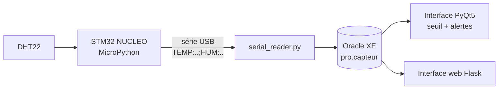

# Système de surveillance de la température et de l'humidité

Projet de stage de perfectionnement (MS-TECHSOFT, janvier 2026) : mesure de la température et de l'humidité avec un capteur **DHT22** branché sur une carte **STM32 NUCLEO-F401RE** (MicroPython), stockage dans **Oracle**, affichage en temps réel dans une interface **PyQt5** et une interface **web Flask**.

## Architecture



## Structure du dépôt

```
firmware/main.py                 Code MicroPython à copier sur la carte
sql/schema.sql                   Création des tables Oracle
src/surveillance/
  config.py                      Configuration (variables d'environnement)
  db.py                          Connexion Oracle
  serial_reader.py               Lecture série -> base de données
  qt_app/                        Interface PyQt5 (app.py + interface.ui)
  web_app/                       Interface web Flask (app.py + templates/)
.env.example                     Modèle de configuration
requirements.txt                 Dépendances Python
```

## Installation

```bash
git clone https://github.com/<votre-pseudo>/surveillance-temperature-humidite.git
cd surveillance-temperature-humidite
python -m venv .venv
.venv\Scripts\activate          # Windows  (Linux/macOS : source .venv/bin/activate)
pip install -r requirements.txt
cp .env.example .env            # puis renseigner DB_PASSWORD, SERIAL_PORT...
```

1. Créer les tables : exécuter `sql/schema.sql` dans Oracle.
2. Flasher MicroPython sur la STM32 et copier `firmware/main.py` (voir le rapport de stage).

## Utilisation

Depuis le dossier `src/` :

```bash
python -m surveillance.serial_reader      # 1. collecte des mesures
python -m surveillance.qt_app.app         # 2a. interface bureau
python -m surveillance.web_app.app        # 2b. interface web -> http://127.0.0.1:5000
```

## Câblage DHT22

| DHT22      | STM32 NUCLEO          |
|------------|-----------------------|
| 1 VCC      | 3,3 V                 |
| 2 DATA     | broche numérique (D5) |
| 3 NC       | non utilisé           |
| 4 GND      | GND                   |

## Auteur

Mohamed Ben Mili : 2ᵉ année Systèmes Embarqués et Mobiles, ISET Charguia. Encadrant : Amine El Gharbi.

Licence MIT.
